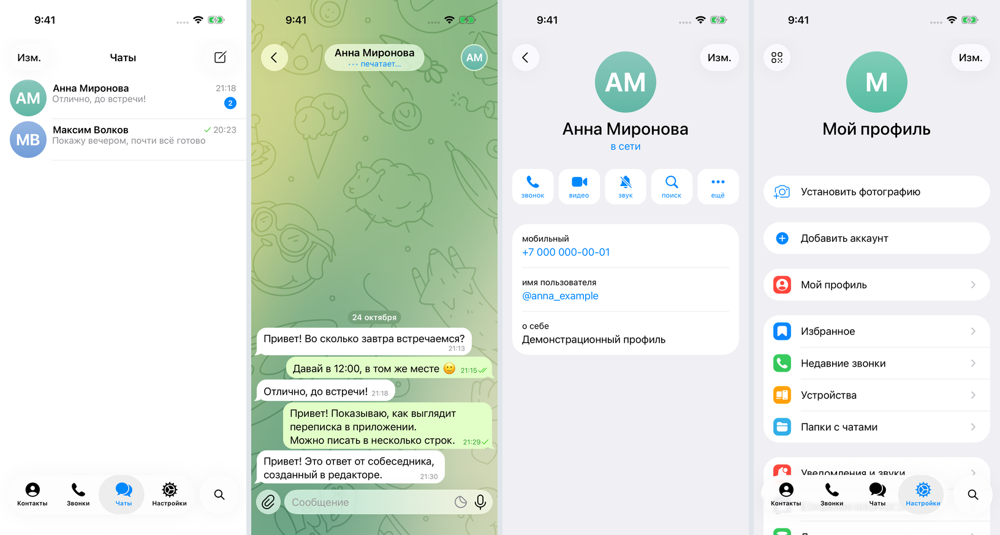

# Нативный Telegram iOS

Активный проект основан на исходниках Telegram iOS 13.1.1. [Единая клиентская сборка iPhone build 12](docs/IPHONE_CLIENT_BUILD.md), исходники `3636175`.

[**Видео 2:59,7**](https://raw.githubusercontent.com/razievdaniil-rgb/telegram_visual_copy/main/docs/videos/Telegram-native-client-demo.mp4) · [Главы и проверка](docs/FEATURE_VIDEO.md) · [Инструкция установки](native/INSTALL_WINDOWS.md).

В одном IPA — штатная шестерёнка, настройки с собственным фото, меню без отдельной нижней лупы, оригинальный узор и локальная смена общих обоев. На Simulator проверены оба аватара, отправка/правка, скрытый редактор, даты/время/галочки, профили/телефон, статусы и сохранение. Обои сохраняются после правок и перезапуска; сброс возвращает стандартный фон.

Пройдены сборки устройства/Simulator из одного коммита, 14 переносимых Swift-тестов, точный патч 26 файлов, TypeScript/lint. Видео записано на Simulator executable из того же коммита; device IPA внутри симулятора не запускался. Подпись и работа на физическом iPhone ещё не проверены. [Состояние и ограничения](docs/STATUS.md).

Ниже сохранён прежний Expo/PWA-прототип.

# Архив: Chat Studio — локальный симулятор переписок

React Native + Expo SDK 57 + Expo Router + TypeScript, Android / iOS. Публичные экраны ориентированы на Telegram для iPhone. Настоящие Telegram-аккаунты и сеть не используются.

Текущий эталон — Telegram iOS **13.1.1**, исходники зафиксированы по коммиту fb0e62b. [Параметры и известные расхождения](docs/TELEGRAM_13_REFERENCE.md).

Проверка текста на iOS Simulator 26.4: длинный текст и исправленный двухстрочный ввод. [Перенос измерения текста из исходников](docs/TEXT_LAYOUT_PORT.md).



## Запуск

Node.js 24 LTS и npm.

```sh
npm ci
npm start
```

Откройте проект в Expo Go на телефоне в той же сети. Для web-превью: `npm run web`. Web помогает проверять сценарии, но не заменяет тестирование на iPhone.

## Редактор

Удерживайте заголовок **«Чаты»** около секунды. В диалоге удерживайте имя собеседника. Редактор также доступен через долгое нажатие заголовка профиля, контактов и настроек.

1. Добавьте собеседника: имя, фамилия, телефон, username, описание, аватар.
2. Создайте с ним чат.
3. Добавьте сообщения, выберите отправителя, дату, время и галочки.
4. Задайте статус собеседника и счётчик непрочитанных; сохраните настройки.
5. Закройте редактор для просмотра. В публичном диалоге поле ввода отправляет сообщения от вашего лица; сообщения собеседника добавляются в редакторе.

Новый проект пустой. Кнопка **«Добавить пример для знакомства»** внутри редактора создаёт демонстрационные данные только по явному нажатию.

Данные автоматически сохраняются локально. Аватары хранятся вместе с документом, без ссылок на временную галерею. Очистка данных или удаление приложения удалит переписки. Облачной копии и экспорта в этой версии нет.

## Проверки

```sh
npm run typecheck
npm run lint
npm test
npm run export:web
npx expo-doctor
```

Проверки модели охватывают обе стороны переписки, редактирование, сортировку по произвольным датам, счётчики, удаление и загрузку сохранённого документа. Ручная приёмка перечислена в [плане](docs/PLAN.md), результаты визуальной сверки — в [отчёте QA](docs/TELEGRAM_13_QA.md).

## Сборки

См. [docs/BUILD.md](docs/BUILD.md). На Windows можно разрабатывать обе платформы, но для нативной iOS-сборки нужен macOS/Xcode или облачный сборщик. Готовые APK/IPA не включены в исходники. Установка на iPhone и подпись проверяются отдельно на устройстве заказчика.

## Объём и визуальное соответствие

[Требования](docs/REQUIREMENTS.md) · [План](docs/PLAN.md).

Оформление сверяется с исходниками Telegram iOS 13.1.1: список, диалог, профиль, контакты, настройки, пустая история звонков и нижняя навигация. Перенесены геометрия и исходные графические ресурсы; [источники, размеры и известные отличия](docs/TELEGRAM_13_REFERENCE.md) зафиксированы. Приложение остаётся на React Native/Expo, без Telegram Core и сети. Предыдущая работа по UI Kit 12.6.1 сохранена в истории Git.

На поддерживаемой iOS 26+ используется нативное Liquid Glass, на остальных платформах — размытие и полупрозрачность. Полное визуальное совпадение требует проверки на реальном iPhone: web на Windows использует другой системный шрифт и не воспроизводит нативное стекло. [Текущее состояние и сборки](docs/STATUS.md).
