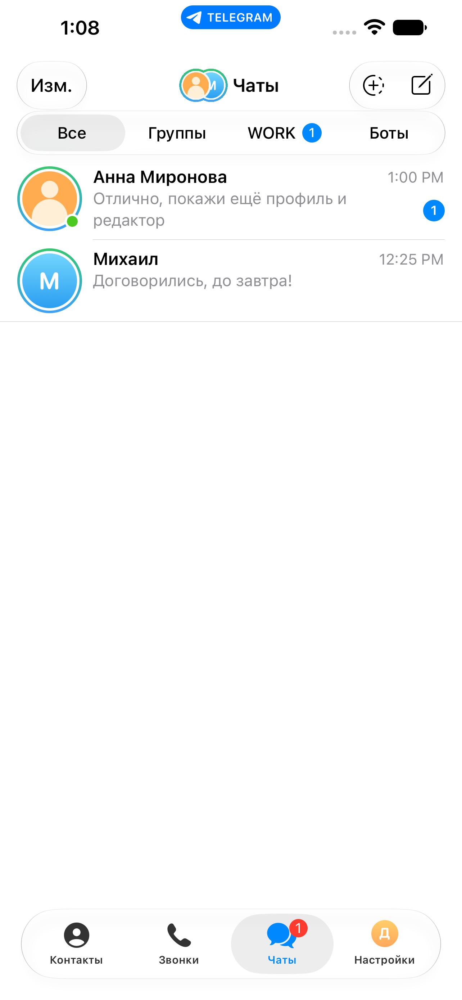
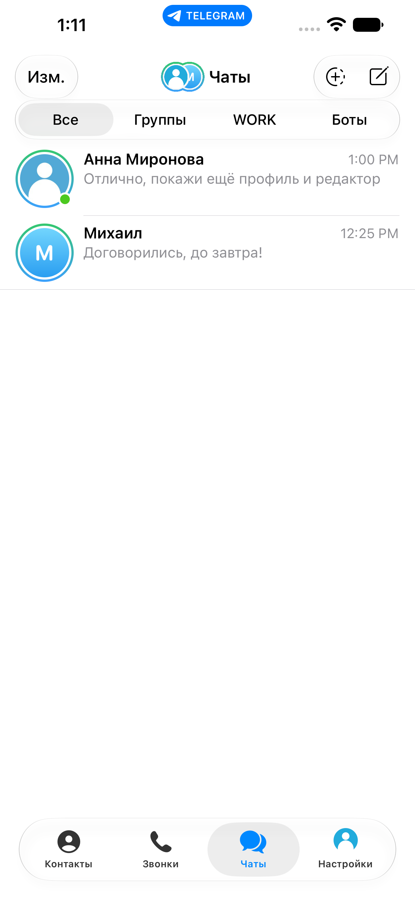
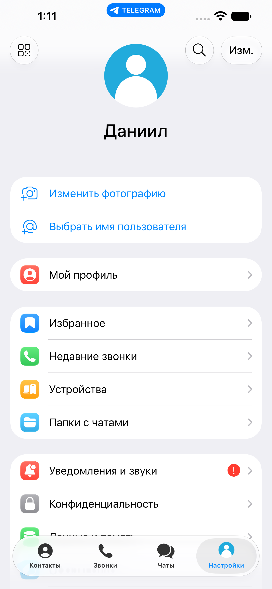
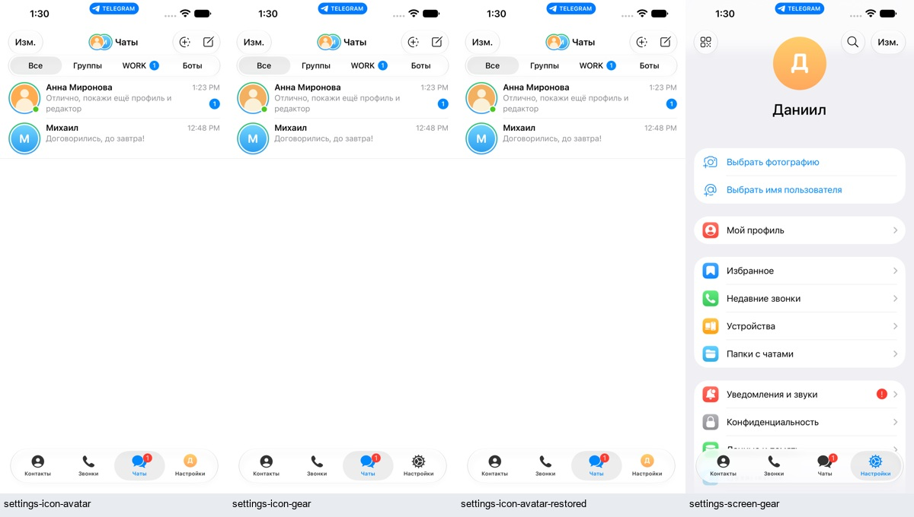

# IPA для iPhone — build 7

[Скачать артефакт GitHub Actions](https://github.com/razievdaniil-rgb/telegram_visual_copy/actions/runs/40683642847/artifacts/12815755906) (требуется доступ к репозиторию). В архиве находится `Telegram.ipa`. В этой рабочей среде копия сохранена в `C:/Users/Daniil/Downloads/Telegram-iPhone-build7.ipa`, инструкция — `C:/Users/Daniil/Downloads/Инструкция-iPhone-build7.txt`.

Версия 13.1.1, build 7, платформа IOS, arm64. Размер 608 286 248 байт. SHA256:

```
0cee2d0f27bf87ac556df5e0b5d15c47016b79a8e461825c15751e0706d1d075
```

Файл не подписан для установки. Sideloadly должен подписать его Apple ID владельца телефона. Файл нельзя установить простым открытием из Telegram. Реальные подпись, запуск на телефоне и повторная подпись ещё не проверены. Инструкция установки находится в [native/INSTALL_WINDOWS.md](../native/INSTALL_WINDOWS.md).

## Изменения клиента

Убрана отдельная нижняя кнопка поиска. Вкладка настроек показывает аватар владельца, использует оригинальный экран настроек и обновляется после смены собственного фото. Фото собеседника не меняет собственный аватар. [Переключение на оригинальную шестерёнку](../native/SETTINGS_APPEARANCE.md) требует изменения одного флага перед следующей сборкой.

Приложение при первой установке пустое. Удержание заголовка «Чаты» открывает редактор. Нужно задать собственный профиль, создать виртуального собеседника и чат. Вход в настоящий Telegram и SMS не нужны. Перед обновлением сохраняйте экспорт документа; удаление приложения удаляет локальные данные.

## Проверено

Обе сборки с исходников `8b302485137b5a707973f690b1da25dd5c330c56` успешны. [Device](https://github.com/razievdaniil-rgb/telegram_visual_copy/actions/runs/40683642847), [Simulator](https://github.com/razievdaniil-rgb/telegram_visual_copy/actions/runs/40683642811). В обоих журналах подтверждено сохранение кэша после сборки. ZIP CRC, SHA256, источник и arm64/IOS проверены локально.

- [Чистая установка](https://github.com/razievdaniil-rgb/telegram_visual_copy/actions/runs/40690700205) — пустой список, скрытый редактор, создание профиля и чата, отправка и сохранение после перезапуска; просмотрены 5 снимков.
- [Основной сценарий](https://github.com/razievdaniil-rgb/telegram_visual_copy/actions/runs/40692521903) — меню, прокрутка/папки, аватар собеседника и собственный аватар, оригинальные настройки, отправка, меню и выделение сообщения, перезапуск; просмотрены 27 снимков. Снимки с названием gear из этого прогона не доказывают переключение иконки: аргумент запуска был булевым. Это исправлено отдельной проверкой ниже.
- [Шестерёнка](https://github.com/razievdaniil-rgb/telegram_visual_copy/actions/runs/40696000474) — строковые YES → NO → YES, один бинарник и документ; просмотрены 4 снимка. Различие аватар/шестерёнка MAE 34.029, восстановленный аватар MAE 0.0. Отрицательный контроль с неизменёнными снимками отвергается.

Дополнительно просмотрены 167 последовательных реальных кадров (PTS 208–217 секунд) закрытия редактора и перехода в настройки. Аватар сохраняется, используется штатная анимация панели. Это проверка Simulator, не измерение плавности физического iPhone.

14 Swift-тестов, точное применение патча к 22 файлам и идентичность 11 оригинальных файлов оформления/анимаций проходят. Шесть изменённых контроллеров перечислены отдельно. TypeScript и lint архивного Expo-прототипа проходят, но не проверяют нативный бинарник.

[Машинный отчёт](builds/native-iphone-build7.json), [хэши исходников](builds/native-iphone-build7-sources.json), [геометрия меню](builds/native-iphone-build7-menu-geometry.json), [сравнение иконок](builds/native-iphone-build7-settings-icons.json), [оригинальные исходники UI](builds/native-iphone-build7-original-ui.json).

## Визуальные свидетельства






## До окончательной приёмки

Подписать и установить на физический iPhone, проверить клавиатуру, галерею/разрешения, сохранение после перезапуска и повторной подписи. Независимая сверка всех экранов и таймингов анимации с App Store Telegram остаётся отдельной проверкой. [Актуальный ролик 2:54](FEATURE_VIDEO.md) снят на уже существующей Simulator-сборке из тех же исходников 8b302485. Старый ролик 2:45 относится к 211bcf2.

## Дополнительная статическая проверка device IPA

Проверены основной Mach-O и все пять вложенных framework executable: arm64, платформа IOS, обязательные зависимости @rpath присутствуют в пакете. Минимальная версия в Info.plist — iOS 15.0, поддерживается семейство iPhone. Описания разрешений фото/камеры присутствуют. Расширений и provisioning profile нет: файл ожидает подпись установщиком. [Полный отчёт](builds/native-iphone-build7-device-preflight.json). Эти проверки не запускают dyld на устройстве и не проверяют результат переподписи Sideloadly.
