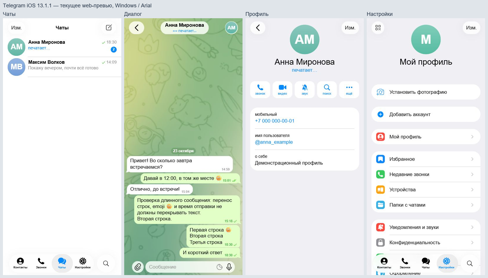

# Проверка Telegram iOS 13.1.1

## Зафиксированный код и эталон

Эталон: Telegram-iOS 13.1.1, commit `fb0e62ba8a147f0821da6aa63c09da7d79a10111`. Старый UI Kit 12.6.1 сохраняется только как история. Значения и ресурсы: [TELEGRAM_13_REFERENCE.md](TELEGRAM_13_REFERENCE.md).

Это снимки приложения при 402×874 в Windows/web, с Arial и fallback-размытием. Системные часы и индикаторы не рисуются. Эти снимки подтверждают работу реализации, но не являются сравнением с нативным Telegram или доказательством совпадения SF/Liquid Glass.

## Проверено

- TypeScript, lint и 15 тестов модели/локального хранения проходят. [Чистый CI 8d64644](https://github.com/razievdaniil-rgb/telegram_visual_copy/actions/runs/39979680237): установка зависимостей, TypeScript, lint, тесты, web-export — успешно.
- Итоговый production export для iOS, Android и web успешен: локальные изображения, SVG и автономные Hermes-бандлы сформированы. Журнал: локальный `artifacts/export-telegram13-final.log`.
- В браузере измерена строка чата 68pt; аватар 60pt; профильная карточка начинается на 304pt после верхнего края содержимого (поправка относительно 8d64644 — ещё 16pt между блоком действий и карточкой).
- Проверены переходы между вкладками, в диалог и профиль; нижний поиск, фильтрация по имени, очистка/закрытие поиска; уведомление недоступных функций.
- Проверены длинное и многострочное сообщение, emoji, отправка и группировка соседних сообщений, одна/две галочки, статус «печатает…» и badge непрочитанных.
- Удержание заголовка открывает скрытый редактор. Из него меняются статус и непрочитанные; на публичном экране элементов редактора нет.
- После reload сохранились 6 сообщений, статус и счётчик. Формат данных не менялся.
- Исправление contacts SVG проверено растрированием: вырез силуэта прозрачный; после сброса Metro-кэша он правильно отображается в приложении. Исходные контуры не перерисованы.

## Нативная проверка

Для 8d64644 запущены:

- [Android APK / unsigned iOS app](https://github.com/razievdaniil-rgb/telegram_visual_copy/actions/runs/39979728910).
- [iOS Simulator screenshots](https://github.com/razievdaniil-rgb/telegram_visual_copy/actions/runs/39979725257).

На момент этой записи выполняется компиляция. Успех и проверка содержимого пакетов не объявлены заранее. Промежуточные запуски 3ee242e отменены, поскольку их заменили проверки 8d64644. Исходный пробный Simulator run 8f73e12 сохранён для диагностики.

Физические iPhone/Android недоступны. Остаются проверка клавиатуры на устройстве, системного увеличения текста/уменьшения прозрачности и сопоставление с эталонными снимками **именно 13.1.1**. В исходном репозитории набора таких снимков нет.

## Известные отличия

- В комплекте исходников есть только миниатюра стандартного узора обоев 155×320. Полноразмерный SVG с официального t.me/bg при запросе возвращает пустой файл. Используется исходная миниатюра, поэтому чёткость узора не считаем готовой для 1:1.
- Статический кадр вкладок и иллюстрации звонков, неподвижная фаза градиента и статическая линза выбора. Оригинальные Lottie/TGS сохранены для дальнейшего переноса движения.
- Скруглённое начертание инициалов отличается от стандартного системного bold. На Android/web также отличаются системный шрифт и материал стекла.
- Текст пустой истории звонков не сверялся с русской локализацией на устройстве 13.1.1.

Из-за этих отличий и отсутствия подтверждённого нативного сравнения полное визуальное совпадение пока не заявляется.
