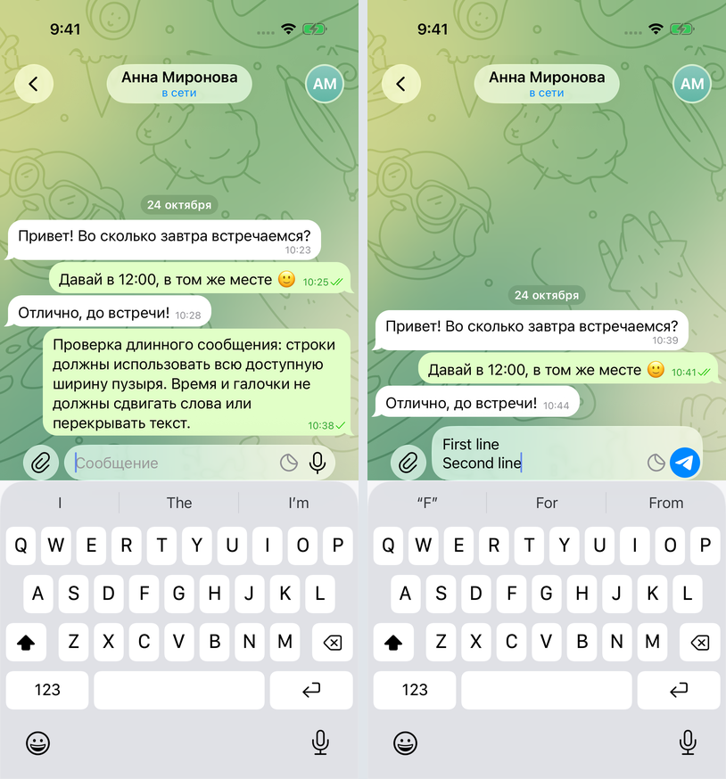
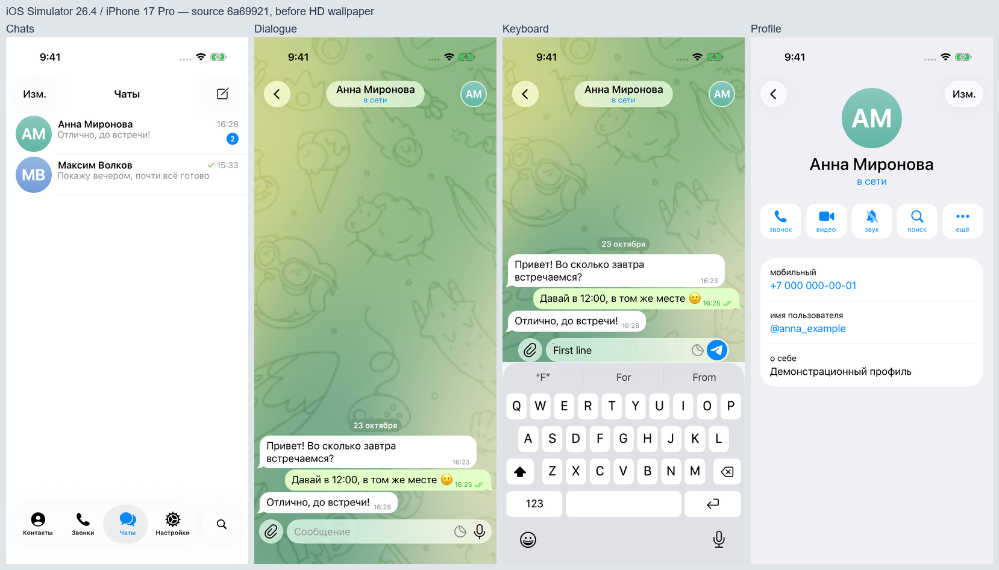

# Общий iOS-стиль и видео — 25 октября 2026

Код: **206e239**. Общие векторные значки и окно уведомлений; локальный Inter для Android/web с четырьмя начертаниями. iOS сохраняет системный SF. Текст, поля и измерение строк используют один механизм выбора шрифта. Фон не меняет масштаб при открытии клавиатуры.

[CI всех платформ](https://github.com/razievdaniil-rgb/telegram_visual_copy/actions/runs/40133684156) успешен: TypeScript, lint, 20 тестов, export iOS/Android/web. Локальные TypeScript/lint и предыдущий all-platform export также прошли.

[Сценарий iPhone 17 Pro / iOS 26.4](https://github.com/razievdaniil-rgb/telegram_visual_copy/actions/runs/40133692978) завершён успешно: чаты → многострочный ввод и отправка → профиль → скрытый редактор → статус «печатает…» и входящее сообщение → контакты → настройки → звонки → чаты. Запись — реальный Simulator, не макет. Исходник 139 секунд / 1206×2622; клиентский MP4 122 секунды / 720×1566, около 3 МБ. Удалены первые 17 секунд ожидания, интерфейс и действия не подменялись. Проверены кадры исходника и сжатой копии, начало/конец и полное декодирование. Шапка редактора не перекрывает системную строку, созданный ответ расположен после исходящего.

[Артефакт с исходным MP4 и снимками](https://github.com/razievdaniil-rgb/telegram_visual_copy/actions/runs/40133692978/artifacts/12575784934). [Происхождение, SHA-256 и история исправления первого сценария](builds/206e239-ios-demo.json). [Сообщение клиенту](CLIENT_UPDATE.md). Большие видео локально находятся в `artifacts/`, в Git не добавлены.

**Границы проверки:** нативный iPhone Simulator проверен; физические iPhone/Android и свежий browser preview — нет. Inter не тождественен SF. Материал Glass, системные клавиатура, emoji и строка состояния отличаются по ОС. Масштаб обоев в оригинальном Telegram, тонкие обводки пузырей, инициалы и анимации требуют финального сравнения с устройством с Telegram 13.1.1. Совпадение пиксель в пиксель не подтверждено. Сборка для установки на телефон клиента ещё не подготовлена.

---

## Архив проверки текста

# Повторная проверка текста — 24 октября 2026

Текущий код: 43632f0. Исправлены измерение текста отдельно от даты, отступы BubbleItemNode и положение даты. Удалён явный kerning=0; iOS использует System. Поле ввода растёт по измеренной высоте строк. Подробности и точные Swift-исходники: [перенос](TEXT_LAYOUT_PORT.md).

[Чистый CI 43632f0](https://github.com/razievdaniil-rgb/telegram_visual_copy/actions/runs/40087159161) успешен: npm ci, TypeScript, lint, 20 тестов, web-export. Локальный production export iOS/Android/web также успешен (`artifacts/export-composer-final.log`).

Нативная проверка на iPhone 17 Pro / iOS 26.4:

- [Полный сценарий edeafe1](https://github.com/razievdaniil-rgb/telegram_visual_copy/actions/runs/40085951816) прошёл с первой попытки. Все девять снимков просмотрены. Длинный русский текст заполняет доступную ширину, время не участвует в переносах; явный перенос сохраняется в отправленном сообщении. [Происхождение и SHA-256](builds/edeafe1-ios-text.json).
- При просмотре снимка ввода обнаружено обрезание второй строки, хотя accessibility-проверка прошла. Поэтому отдельно исправлен рост поля.
- [Целевой сценарий 43632f0](https://github.com/razievdaniil-rgb/telegram_visual_copy/actions/runs/40087171042) также прошёл с первой попытки. Оба снимка просмотрены: две строки полностью видны до отправки, сообщение сохраняет перенос, пустое поле возвращается к исходной высоте. [Отчёт и SHA-256](builds/43632f0-ios-composer.json).

Нативная оболочка из 6a69921 повторно использовалась после проверки отсутствия изменений package.json, lockfile и app.json; Hermes bundle и ресурсы сформированы из исходников соответствующего прогона. Предварительный прогон 44b9840 отменён; f714b14 остановился на поиске поля по label, после чего введён стабильный testID.

SF не встроен в Windows/Android; эти платформы сохраняют другой шрифт. Основание и ссылка на официальную лицензию Apple приведены в карте переноса. Браузерная проверка текущей версии не проведена: инструмент отклонил доступ к localhost, ограничение не обходилось. Физические устройства, эталонный Telegram 13.1.1 и совпадение пиксель в пиксель не проверены.

## Архив предыдущей проверки

---

# Проверка Telegram iOS 13.1.1

## Зафиксированный код и эталон

Эталон: Telegram-iOS 13.1.1, commit `fb0e62ba8a147f0821da6aa63c09da7d79a10111`. Старый UI Kit 12.6.1 сохраняется только как история. Значения и ресурсы: [TELEGRAM_13_REFERENCE.md](TELEGRAM_13_REFERENCE.md).

Это снимки приложения при 402×874 в Windows/web, с Arial и fallback-размытием. Системные часы и индикаторы не рисуются. Эти снимки подтверждают работу реализации, но не являются сравнением с нативным Telegram или доказательством совпадения SF/Liquid Glass.

## Проверено

- TypeScript, lint и 15 тестов модели/локального хранения проходят. [Чистый CI 8d64644](https://github.com/razievdaniil-rgb/telegram_visual_copy/actions/runs/39979680237): установка зависимостей, TypeScript, lint, тесты, web-export — успешно.
- Итоговый production export с HD-обоями для iOS, Android и web успешен: локальные изображения, SVG и автономные Hermes-бандлы сформированы. Журнал: локальный `artifacts/export-telegram13-hd.log`.
- В браузере измерена строка чата 68pt; аватар 60pt; профильная карточка начинается на 304pt после верхнего края содержимого (поправка относительно 8d64644 — ещё 16pt между блоком действий и карточкой).
- Проверены переходы между вкладками, в диалог и профиль; нижний поиск, фильтрация по имени, очистка/закрытие поиска; уведомление недоступных функций.
- Проверены длинное и многострочное сообщение, emoji, отправка и группировка соседних сообщений, одна/две галочки, статус «печатает…» и badge непрочитанных.
- Удержание заголовка открывает скрытый редактор. Из него меняются статус и непрочитанные; на публичном экране элементов редактора нет.
- После reload сохранились 6 сообщений, статус и счётчик. Формат данных не менялся.
- Исправление contacts SVG проверено растрированием: вырез силуэта прозрачный; после сброса Metro-кэша он правильно отображается в приложении. Исходные контуры не перерисованы.

## Нативная проверка

Для 8d64644 завершены:

- [Android APK / unsigned iOS app](https://github.com/razievdaniil-rgb/telegram_visual_copy/actions/runs/39979728910): обе сборки успешны. [Проверка пакетов и SHA-256](builds/8d64644.json); APK/IPA скачаны в локальный `artifacts/builds/8d64644/`, CRC верны, JavaScript-бандлы есть. Исходные SVG проверены после нормализации LF, PNG — по RGBA-пикселям (Android перепаковывает PNG). Проверены исправленная иконка контактов, обои, иллюстрация звонков и микрофон. Эти пакеты предшествуют поправке 16pt в профиле из 5cab6a1.
- [iOS Simulator screenshots](https://github.com/razievdaniil-rgb/telegram_visual_copy/actions/runs/39979725257).

Первоначальные переходы через simctl openurl вызвали системное подтверждение «Open in ChatStudio?». Эти снимки отклонены; сценарий переведён на обычные нажатия через Maestro CLI 2.11.0. В первом Maestro-прогоне исправлена проверка accessibility-label поля; после тайм-аута холодного старта драйвера увеличено время его запуска.

Итоговый [Maestro-прогон 39987228410](https://github.com/razievdaniil-rgb/telegram_visual_copy/actions/runs/39987228410) **успешен**: список → диалог → клавиатура → профиль → контакты → настройки → звонки. Все семь снимков просмотрены, системных запросов поверх экранов нет. Использован собранный .app из 6a69921: он включает поправку профиля 16pt, но предшествует HD-обоям. Проверка SHA-256 и происхождение: [отчёт](builds/6a69921-ios-visual.json).

Снимок клавиатуры подтверждает положение поля над системной клавиатурой и набор первой строки. Рост многострочного поля на iOS этим прогоном не доказан; многострочный ввод проверен в web. Снимки показывают наше приложение, а не Telegram-эталон.

Физические iPhone/Android недоступны. Остаются проверка клавиатуры на устройстве, системного увеличения текста/уменьшения прозрачности и сопоставление с эталонными снимками **именно 13.1.1**. В исходном репозитории набора таких снимков нет.

## Известные отличия

- Миниатюра обоев заменена на растр 1550×3200 из совпадающего исходного вектора Telegram Web. Кадрирование сопоставлено с оригинальным ресурсом iOS: 217 инлайеров SIFT по всей площади, корреляция финального альфа-канала 0,9576. Исходный PNG и SVG сохранены. Окончательный масштаб/кадрирование относительно реального Telegram 13.1.1 ещё требуют эталонного снимка; нативный .app 6a69921 и пакеты 8d64644 предшествуют HD-растру, но используют ту же геометрию.
- Статический кадр вкладок и иллюстрации звонков, неподвижная фаза градиента и статическая линза выбора. Оригинальные Lottie/TGS сохранены для дальнейшего переноса движения.
- Скруглённое начертание инициалов отличается от стандартного системного bold. На Android/web также отличаются системный шрифт и материал стекла.
- Текст пустой истории звонков не сверялся с русской локализацией на устройстве 13.1.1.

Из-за этих отличий и отсутствия подтверждённого нативного сравнения полное визуальное совпадение пока не заявляется.
