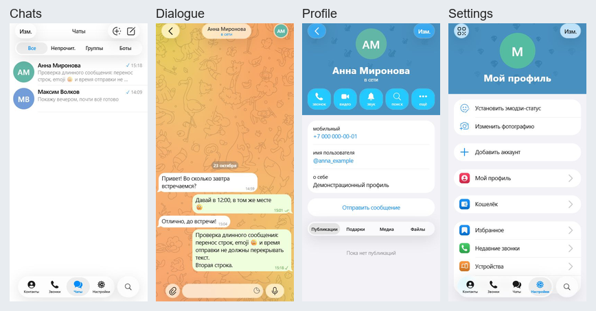

> Исторический отчёт по UI Kit 12.6.1. С 23 октября 2026 актуальный эталон — **Telegram iOS 13.1.1**: [текущая спецификация](TELEGRAM_13_REFERENCE.md). Приведённые ниже размеры и сравнения не подтверждают совпадение с 13.1.1.

# Визуальная проверка UI Kit

## Среда и доказательства

Web-превью на Windows, размер viewport 402×812: это экран макета 402×874 без системной строки 62 pt. Скриншоты приложения сохранены локально в `artifacts/screenshots/ios-kit/`: список, диалог, профиль, контакты и настройки. Исходные изображения и контексты макетов — в `artifacts/references/`.

Функциональная проверка выполнена на локальных демонстрационных профилях. Текст и аватары отличаются от примеров Figma, поэтому общий процент pixel-diff не используется как показатель точности.

Для списка и диалога созданы наложения с прозрачностью 50%: `chats-overlay.png` и `dialogue-overlay.png`. Верхняя панель и геометрия строк сверены. Нижняя панель списка в образце сдвинута вверх дополнительной полосой мини-приложений Wallet высотой 84 pt; эта полоса вне объёма симулятора, поэтому в приложении навигация закреплена у нижнего safe area. Медиа в диалоге образца также вне объёма; сравнивается оформление текстовых сообщений и управления. Исправлен разделитель даты: белый текст на затемнённой размытой плашке, без светлого стеклянного бордюра.

## Проверено в браузере

- Строка чата 78 pt (измерение DOM), аватар 62 pt, ширина приложения 402 pt.
- Заголовок, фильтры, нижняя капсула, четыре вкладки и поиск. Поиск по имени находит только нужную переписку; закрытие восстанавливает список.
- Скрытый вход удержанием заголовка, добавление примеров из редактора, отсутствие видимых кнопок редактора в публичных экранах.
- Короткие и многострочные сообщения, emoji, одна/две галочки, подпись времени, дата; текст не перекрывается метаданными. Отправка очищает поле ввода.
- Профиль содержит фактические имя, телефон, username и описание; отсутствие аватара показывает инициалы.
- Контакты и настройки используют реальные профили; неработающие функции показывают уведомление. Закрытие уведомления возвращает управление.
- Перезагрузка сохраняет профили и сообщения. Модель/хранилище отдельно покрыты существующими 15 тестами.
- Исправлена цветовая особенность COLR-шрифта: неактивные значки чёрные, выбранная вкладка синяя, действия в профиле белые.

## Платформенные различия и непроверенные состояния

| Область             | Состояние                                                                                                                                             |
| ------------------- | ----------------------------------------------------------------------------------------------------------------------------------------------------- |
| SF Pro              | На iOS системный; на Windows/Android системная замена, поэтому метрики и переносы могут отличаться. Веса 510/590 приближены к 500/600.                |
| Liquid Glass        | Реальный GlassView доступен на поддерживаемой iOS 26+. Остальные платформы используют blur/полупрозрачность. Нативная визуальная сверка не выполнена. |
| Системные отступы   | Используются safe-area insets ОС. Web имеет нулевые insets, поэтому нижние элементы расположены ниже, чем в полном iPhone-макете.                     |
| Клавиатура          | Реальная системная, адаптация реализована; требуется проверка iPhone/Android с вводом, скрытием и прокруткой.                                         |
| Увеличение текста   | Строки имеют minHeight и могут расти; длинные имена ограничены одной строкой. Требуется проверка максимальных системных масштабов.                    |
| Доступность         | Реализованы reduce motion и reduce transparency iOS, но переключение системных настроек на устройстве не проверено.                                   |
| Звонки              | Пустое состояние в общей теме; отдельного зафиксированного эталона пустого экрана нет.                                                                |
| Декоративные данные | Истории, premium-метки, медиа и примерные аватары из Figma не подставляются в пользовательские переписки.                                             |

## Проверка на устройствах перед визуальной приёмкой

1. На iPhone с iOS 26+ снять те же экраны при ширине 402 pt; сравнить с Figma наложением без аппаратной рамки.
2. Проверить прокрутку под стеклом, keyboard show/hide, длинные имена/сообщения, разные дни, группировку и редактирование времени/галочек.
3. Включить крупный текст, уменьшение движения и прозрачности; проверить читаемость и доступность управления.
4. На Android проверить fallback-размытие, нижний системный inset, клавиатуру, аватары и перезапуск с сохранёнными данными.
5. Зафиксировать найденные расхождения и исправить их до утверждения полного визуального совпадения.
